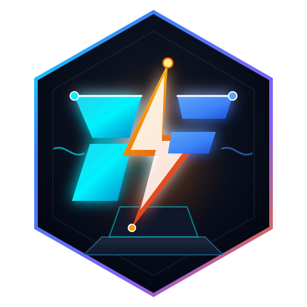
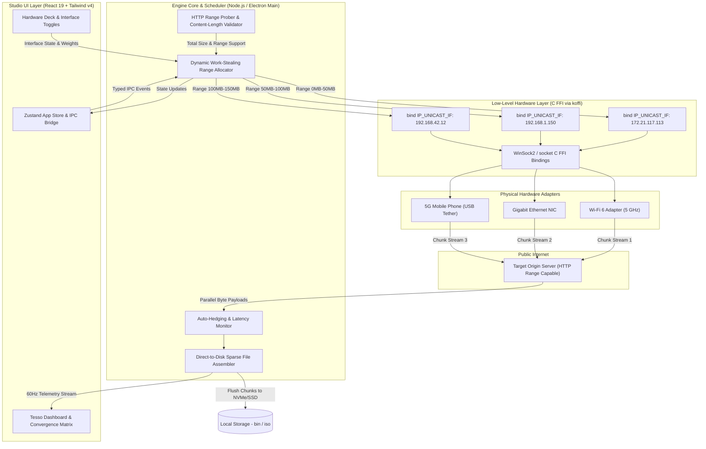

<p align="center">
  
</p>

<h1 align="center">Tesso</h1>

<p align="center">
  <strong>Next-Gen Multi-WAN Aggregation & Network Platform</strong><br>
  Tesso dynamically aggregates Wi-Fi, Ethernet, and Mobile 4G/5G USB tethering to accelerate download speeds, web browsing, and data streams with zero remote server costs.
</p>

<p align="center">
  <a href="#features">Features</a> •
  <a href="#how-it-works">How It Works</a> •
  <a href="#browser-multi-wan">Browser Multi-WAN</a> •
  <a href="#architecture">Architecture</a> •
  <a href="#data-flow">Data Flow</a> •
  <a href="#faq">FAQ</a> •
  <a href="#quick-start">Quick Start</a> •
  <a href="#license">License</a>
</p>

---

## <a id="features" name="features"></a>⚡ Features

- **Multi-Network Aggregation ($0 Server Cost):** Combines Wi-Fi, Ethernet, and 4G/5G mobile tethering on your local machine using raw C FFI socket binding (`koffi`) and Windows source routing.
- **Dynamic Range Chunking:** Automatically segments large transfers into parallel byte ranges across participating interfaces.
- **The Tesso Matrix Visualizer:** Real-time stream telemetry showing individual throughput per adapter converging into the unified woven stream.
- **Multi-Route Auto-Hedging & Failover:** Seamlessly balances connections across adapters, auto-retrying and reassigning chunks if one connection suffers latency spikes or disconnects.
- **Per-Network Controls:** Configure individual traffic weights, toggle interfaces mid-download, and set custom data limits.
- **Studio UI:** Cyber-slate dark console with real-time throughput metrics, chunk visualizer strips, and hardware adapter health decks.

---

## <a id="how-it-works" name="how-it-works"></a>🛠️ How It Works

Traditional applications route all outgoing TCP traffic through the operating system's single default routing table entry. Even if your computer is plugged into Ethernet, connected to 5GHz Wi-Fi, and tethered to a 5G phone simultaneously, normal apps only use one interface at a time.

**Tesso** bypasses this limitation purely on the client side without needing a remote cloud VPS or paid proxy relay:

1. **Adapter Discovery:** Interrogates network hardware (Wi-Fi, USB NDIS cellular tether, Ethernet) via native Windows Network APIs.
2. **Socket Binding (C FFI):** Binds each parallel socket directly to specific local interface IP addresses using native C FFI (`koffi`) socket calls (`bind()` and `IP_UNICAST_IF` / `SO_BINDTODEVICE`).
3. **HTTP Range Chunking:** Requests specific byte ranges (`bytes=start-end`) concurrently over each bonded interface.
4. **Direct Stream Assembler:** Writes arriving chunks directly into pre-allocated sparse files on disk with zero memory overhead.

---

## <a id="browser-multi-wan" name="browser-multi-wan"></a>🌐 Browser Multi-WAN Acceleration (Chrome, Edge & System)

Beyond file downloads, Tesso accelerates general web browsing and video streaming across all connected networks via an embedded local forward proxy and automatic configuration server:

- **Local Forward Proxy (`127.0.0.1:9090`)**: Dispatches outbound HTTP requests and HTTPS `CONNECT` tunnels across your physical adapters using least-connections round-robin scheduling.
- **PAC Auto-Config Server (`http://127.0.0.1:9091/proxy.pac`)**: Serves a dynamic Proxy Auto-Configuration (PAC) script directly to browsers. Local and intranet domains are routed `DIRECT`, while public internet streams are multiplexed across your bonded adapters.

### 4 Ways to Connect Your Browser:

#### Option 1: Command Prompt (CMD) — Recommended Quickest

In standard Windows Command Prompt (`cmd.exe`), the built-in `start` command automatically resolves Google Chrome's path:

```cmd
start chrome --proxy-pac-url=http://127.0.0.1:9091/proxy.pac
```

#### Option 2: Full Executable Path (PowerShell & CMD)

If `chrome.exe` is not in your system environment PATH, launch via Chrome's default install directory:

- **Command Prompt (CMD):**
  ```cmd
  "C:\Program Files\Google\Chrome\Application\chrome.exe" --proxy-pac-url=http://127.0.0.1:9091/proxy.pac
  ```
- **PowerShell:**
  ```powershell
  & "C:\Program Files\Google\Chrome\Application\chrome.exe" --proxy-pac-url=http://127.0.0.1:9091/proxy.pac
  ```

#### Option 3: Tesso Companion Extension (Permanent in Chrome, Brave, Edge & Arc)

Zero terminal commands needed:

1. **Direct Drag-and-Drop Install (`.crx`) — 100% Free ($0):**
   - Download [`releases/tesso.crx`](https://github.com/dhairya-404/Tesso/raw/main/releases/tesso.crx).
   - In Brave (`brave://extensions`) or Chrome (`chrome://extensions`), toggle on **Developer mode** in the top-right corner.
   - Drag and drop `tesso.crx` into your browser window and click **Add extension**. It is permanently installed!
2. **Local Unpacked Install:**
   - In `chrome://extensions` or `brave://extensions`, click **Load unpacked** and select `extension/dist/chrome`.
   - _Permanence Note:_ Unpacked extensions remain **permanently installed** across browser restarts and PC reboots. (Brave runs them silently with zero popups).
3. **Store 1-Click Distribution:**
   - Use [`releases/tesso-chrome-extension.zip`](https://github.com/dhairya-404/Tesso/raw/main/releases/tesso-chrome-extension.zip) to publish to Microsoft Edge Partner Center ($0 Free) or Google Chrome Web Store.
4. Click the **Tesso** icon in your browser toolbar and toggle **Accelerate Browser (Multi-WAN)**.

#### Option 4: System-Wide Windows Proxy (Accelerates All Browsers)

Route all browsers (Chrome, Edge, Brave, Firefox, Arc) through Tesso without command line flags:

1. Press `Win + I` to open **Windows Settings**.
2. Navigate to **Network & Internet** → **Proxy**.
3. Under **Automatic proxy setup**, turn ON **Use setup script**.
4. Set the Script address:
   ```
   http://127.0.0.1:9091/proxy.pac
   ```
5. Click **Save**. All browser sessions will now automatically distribute across your bonded adapters.

---

## <a id="architecture" name="architecture"></a>🏗️ Architecture

Tesso is engineered with a modular, high-throughput pipeline that separates the reactive studio UI from the low-level native networking engine:



### Component Layer Breakdown

| Layer                    | Technologies                               | Responsibilities                                                                                                          |
| ------------------------ | ------------------------------------------ | ------------------------------------------------------------------------------------------------------------------------- |
| **Presentation (UI)**    | React 19, Tailwind CSS v4, Lucide, Zustand | Studio dark theme, dynamic Tesso Convergence Matrix, 60Hz aggregated throughput gauges, hardware adapter health monitors. |
| **Desktop Shell**        | Electron 44, ContextBridge, Vite HMR       | Secure sandboxed IPC boundary, window lifecycle, native dialogs, global keyboard shortcuts.                               |
| **Engine Orchestrator**  | Node.js, TypeScript                        | Dynamic range chunk calculator, work-stealing task queue, slow connection auto-hedging, retry policies.                   |
| **Native Socket Engine** | C FFI (`koffi`), WinSock2                  | Direct low-level OS socket binding to interface IP addresses, bypassing the default gateway routing table.                |
| **Storage Engine**       | Node.js Native I/O (`fs`), Sparse Files    | Direct block positioning, atomic chunk commits, real-time download progress maps.                                         |

---

## <a id="data-flow" name="data-flow"></a>🔄 Data Flow

1. **Ingestion & Capability Probe:** When a download URL is entered or intercepted, Tesso sends a lightweight `HEAD` / probe request to verify `Accept-Ranges: bytes` and determine file size.
2. **Dynamic Chunk Partitioning:** The total payload is divided into optimized chunk blocks (typically 10MB to 50MB depending on total size).
3. **Interface Sizing & Socket Creation:** For every active hardware interface, a dedicated socket is created and explicitly bound using low-level C FFI to that adapter's assigned local IP address.
4. **Adaptive Work-Stealing:** Sockets request available chunks concurrently. Faster adapters (e.g., 5G tethering or gigabit fiber) complete chunks rapidly and immediately pull new chunks from the queue, preventing slower links from bottlenecking the overall job.
5. **Direct Disk Write:** Arriving TCP buffers are written directly to their target file byte offsets without holding the full file in RAM.
6. **Live Telemetry:** Throughput stats from each adapter are piped to the React frontend at up to 60 updates/sec to animate the Convergence Matrix visualizer.

---

## <a id="faq" name="faq"></a>❓ Frequently Asked Questions (FAQ)

### 1. What is Tesso in simple terms?

Most computers have multiple network interfaces connected at the same time—such as home Wi-Fi, Ethernet, and a smartphone connected over USB tethering. Standard operating systems only use **one** connection at a time, leaving the rest completely idle. **Tesso** is a client-side engine that aggregates all active networks into a unified pipe to accelerate file transfers, streaming, and Google Chrome web browsing without requiring any paid cloud proxy.

### 2. How does Tesso combine networks with zero server fees ($0)?

Traditional bonding tools (like Speedify) require expensive cloud VPN servers to split and reassemble packets. Tesso operates **100% locally on your machine**:

- **For Downloads:** Tesso splits files into byte ranges (`bytes=start-end`) and requests separate chunks over separate network adapters using native socket binding (`IP_UNICAST_IF`). The pieces are written directly to disk at their exact file offsets.
- **For Browsing:** Tesso runs a local forward proxy daemon on `127.0.0.1:9090` that dispatches outgoing TCP connections across active physical interfaces using dynamic least-connections round-robin scheduling.

### 3. How does Tesso compare to Speedify?

| Feature                   | **Tesso**                                     | **Speedify**                               | **Standard Download Managers** |
| :------------------------ | :-------------------------------------------- | :----------------------------------------- | :----------------------------- |
| **Monthly Subscription**  | **$0 / Free & Open Source**                   | \$10 to \$15 / month                       | Free                           |
| **Server Infrastructure** | **Zero remote servers**                       | Requires proprietary VPN servers           | Zero servers                   |
| **Data Privacy**          | **100% Direct to destination** (no middleman) | Traffic inspected/routed via 3rd-party VPN | Direct                         |
| **Scope**                 | **File Downloads + Chrome / Web Browsing**    | All system traffic                         | Downloads only                 |
| **Stall Hedging**         | **Automatic packet stall detection**          | Server-side retransmit                     | Manual restart on failure      |
| **Hardware Control**      | **Per-interface toggles & live metrics**      | High-level interface sliders               | None                           |

### 4. What kinds of network connections can I bond together?

Any network connection recognized by your operating system can be bonded:

- **Wi-Fi** (2.4 GHz, 5 GHz, Wi-Fi 6/6E/7)
- **4G / 5G Mobile Hotspot** via USB Cable Tethering (NDIS)
- **Gigabit Ethernet / Fiber LAN**
- **Secondary Wi-Fi** (via a USB Wi-Fi dongle)
- **Bluetooth PAN Tethering**

### 5. What happens if one connection (e.g. mobile hotspot) disconnects mid-download?

Tesso features **dynamic auto-hedging and failover**. If one connection experiences packet loss, latency spikes, or drops off entirely:

1. The engine marks the stalled block as abandoned.
2. The remaining healthy connections immediately pick up the abandoned byte range and finish it.
3. The transfer finishes without errors, without restarting, and without corrupting the file on disk.

### 6. Is the telemetry on the dashboard real or simulated?

**100% real dynamic telemetry.** When no downloads or proxy streams are active, Tesso shows `0 B/s (Standby)` and `1.0x` baseline multiplier. When transfers run, the gauges and Convergence Matrix show the actual live bytes per second flowing through each physical network card.

### 7. Does Tesso require administrator / root privileges?

No. Standard user privileges are sufficient. Tesso uses standard operating system socket binding APIs (`bind()` with `localAddress` on Node.js / Electron), which do not require kernel driver installation or elevated administrator permissions.

### 8. Can I install the Tesso Companion Extension permanently in Chrome, Brave, and Edge?

Yes. There are two permanent installation methods:

- **Local Unpacked Permanence:** When loaded via `chrome://extensions` or `brave://extensions` with Developer Mode enabled, the extension **persists permanently across all browser restarts, tab closures, and PC reboots**. It only unloads if you manually delete the directory or click "Remove".
- **Store 1-Click Permanence Everywhere:** The project generates `extension/dist/tesso-chrome-extension.zip`. Once published to the Chrome Web Store (as Public or Unlisted), anyone on Chrome, Brave, Edge, Arc, or Opera can install it permanently with 1 click without ever opening Developer Mode.

---

## <a id="quick-start" name="quick-start"></a>🚀 Quick Start

### Prerequisites

- **Operating System:** Windows 10/11 (macOS / Linux support via socket FFI)
- **Node.js:** v20+ or v22+
- **npm:** v10+

### Development Setup

```bash
# Clone the repository
git clone https://github.com/dhairya-404/Tesso.git
cd Tesso

# Install dependencies
npm install

# Start development mode (Electron + Vite HMR)
npm run dev
```

### Production Build

```bash
# Typecheck TypeScript
npm run typecheck

# Build and unpack native desktop application
npm run build:unpack

# Build Chrome and Firefox companion extensions
npm run build:extension
```

The compiled standalone executable will be located in `dist/win-unpacked/tesso.exe`.

---

## <a id="license" name="license"></a>📄 License

MIT License. Copyright (c) 2026 Dhairya. All rights reserved.
