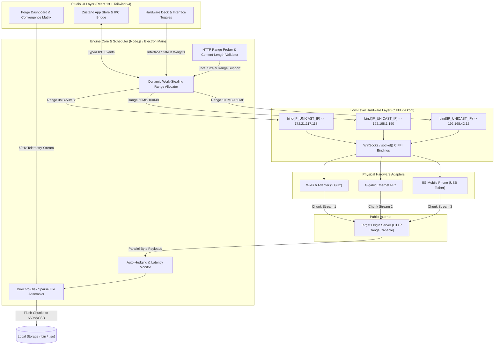

<p align="center">
  
</p>

<h1 align="center">BondForge</h1>

<p align="center">
  <strong>Next-Gen Multi-WAN Download & Bandwidth Aggregation Engine</strong><br>
  BondForge dynamically aggregates Wi-Fi, Ethernet, and Mobile 4G/5G USB tethering to accelerate download speeds with zero remote server costs.
</p>

<p align="center">
  <a href="#features">Features</a> •
  <a href="#how-it-works">How It Works</a> •
  <a href="#architecture">Architecture</a> •
  <a href="#data-flow">Data Flow</a> •
  <a href="#quick-start">Quick Start</a> •
  <a href="#build-from-source">Build</a> •
  <a href="#license">License</a>
</p>

---

## ⚡ Features

- **Multi-Network Aggregation ($0 Server Cost):** Combines Wi-Fi, Ethernet, and 4G/5G mobile tethering on your local machine using raw C FFI socket binding (`koffi`) and Windows source routing.
- **Dynamic Range Chunking:** Automatically segments large downloads into parallel byte ranges across participating interfaces.
- **The Forge Matrix Visualizer:** Real-time stream telemetry showing individual throughput per adapter converging into the unified forged stream.
- **Multi-Route Auto-Hedging & Failover:** Seamlessly balances connections across adapters, auto-retrying and reassigning chunks if one connection suffers latency spikes or disconnects.
- **Per-Network Controls:** Configure individual traffic weights, toggle interfaces mid-download, and set custom data limits.
- **Studio UI:** Cyber-slate dark console with real-time throughput metrics, chunk visualizer strips, and hardware adapter health decks.

---

## 🛠️ How It Works

Traditional download managers route all outgoing TCP traffic through the operating system's single default routing table entry. Even if your computer is plugged into Ethernet, connected to 5GHz Wi-Fi, and tethered to a 5G phone simultaneously, normal apps only use one interface at a time.

**BondForge** bypasses this limitation purely on the client side without needing a remote cloud VPS or paid proxy relay:

1. **Adapter Discovery:** Interrogates network hardware (Wi-Fi, USB NDIS cellular tether, Ethernet) via native Windows Network APIs.
2. **Socket Binding (C FFI):** Binds each parallel socket directly to specific local interface IP addresses using native C FFI (`koffi`) socket calls (`bind()` and `IP_UNICAST_IF` / `SO_BINDTODEVICE`).
3. **HTTP Range Chunking:** Requests specific byte ranges (`bytes=start-end`) concurrently over each bonded interface.
4. **Direct Stream Assembler:** Writes arriving chunks directly into pre-allocated sparse files on disk with zero memory overhead.

---

## 🏗️ Architecture

BondForge is engineered with a modular, high-throughput pipeline that separates the reactive studio UI from the low-level native networking engine:



### Component Layer Breakdown

| Layer                    | Technologies                               | Responsibilities                                                                                                          |
| ------------------------ | ------------------------------------------ | ------------------------------------------------------------------------------------------------------------------------- |
| **Presentation (UI)**    | React 19, Tailwind CSS v4, Lucide, Zustand | Studio dark theme, dynamic Forge Convergence Matrix, 60Hz aggregated throughput gauges, hardware adapter health monitors. |
| **Desktop Shell**        | Electron 44, ContextBridge, Vite HMR       | Secure sandboxed IPC boundary, window lifecycle, native dialogs, global keyboard shortcuts.                               |
| **Engine Orchestrator**  | Node.js, TypeScript                        | Dynamic range chunk calculator, work-stealing task queue, slow connection auto-hedging, retry policies.                   |
| **Native Socket Engine** | C FFI (`koffi`), WinSock2                  | Direct low-level OS socket binding to interface IP addresses, bypassing the default gateway routing table.                |
| **Storage Engine**       | Node.js Native I/O (`fs`), Sparse Files    | Direct block positioning, atomic chunk commits, real-time download progress maps.                                         |

---

## 🔄 Data Flow

1. **Ingestion & Capability Probe:** When a download URL is entered or intercepted, BondForge sends a lightweight `HEAD` / probe request to verify `Accept-Ranges: bytes` and determine file size.
2. **Dynamic Chunk Partitioning:** The total payload is divided into optimized chunk blocks (typically 10MB to 50MB depending on total size).
3. **Interface Sizing & Socket Creation:** For every active hardware interface, a dedicated socket is created and explicitly bound using low-level C FFI to that adapter's assigned local IP address.
4. **Adaptive Work-Stealing:** Sockets request available chunks concurrently. Faster adapters (e.g., 5G tethering or gigabit fiber) complete chunks rapidly and immediately pull new chunks from the queue, preventing slower links from bottlenecking the overall job.
5. **Direct Disk Write:** Arriving TCP buffers are written directly to their target file byte offsets without holding the full file in RAM.
6. **Live Telemetry:** Throughput stats from each adapter are piped to the React frontend at up to 60 updates/sec to animate the Convergence Matrix visualizer.

---

## 🚀 Quick Start

### Prerequisites

- **Operating System:** Windows 10/11 (macOS / Linux support via socket FFI)
- **Node.js:** v20+ or v22+
- **npm:** v10+

### Development Setup

```bash
# Clone the repository
git clone https://github.com/dhairya-404/BandForge.git
cd BandForge

# Install dependencies
npm install

# Start development mode (Electron + Vite HMR)
npm run dev
```

### Production Build

```bash
# Typecheck TypeScript
npm run typecheck

# Build and unpack native desktop application
npm run build:unpack
```

The compiled standalone executable will be located in `dist/win-unpacked/bondforge.exe`.

---

## 📄 License

MIT License. Copyright (c) 2026 Dhairya. All rights reserved.
